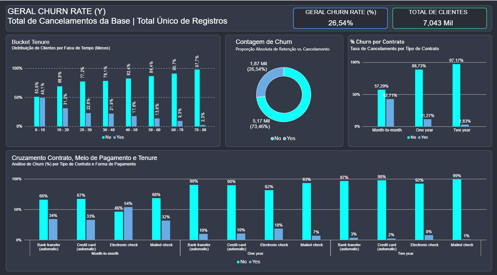

# 📊 Análise de Churn em Empresa de Telecomunicações (Telco Customer Churn)

Projeto de análise de dados **End-to-End** desenvolvido para identificar gargalos operacionais e propor estratégias de retenção de clientes em uma operadora de telecomunicações[cite: 3].

---

## 🎯 Pergunta de Negócio
> *"A empresa quer reduzir o cancelamento (churn) de clientes. Quais características de contrato e forma de pagamento têm a maior taxa de churn, e qual segmento de clientes deveria receber uma ação de retenção prioritária?"*[cite: 3]

---

## 🖥️ Dashboard Interativo (Power BI)
*Visão geral do painel analítico desenvolvido em Dark Mode:*

---

## 🛠️ Ferramentas e Tecnologias Utilizadas
O projeto foi estruturado utilizando a mesma base de dados sob três perspectivas analíticas diferentes[cite: 3]:
* **Excel:** Análise exploratória inicial, tabelas dinâmicas e validação de métricas base[cite: 4].
* **SQL (SQLite):** Manipulação de dados, consultas avançadas, uso de CTEs (`WITH`) e criação de *buckets* de tempo (*tenure*)[cite: 5].
* **Power BI:** Construção do dashboard interativo e visualização de dados focada em tomada de decisão[cite: 2, 7].

---

## 📈 Etapas da Análise

1. **Etapa 01 - Excel:** 
   * Exploração inicial da base com 7.043 clientes e taxa geral de churn de 26,54%[cite: 3, 4].
   * Cruzamento preliminar de variáveis como tipo de contrato, tempo de casa (*tenure*) e formas de pagamento[cite: 4].

2. **Etapa 02 - SQL:** 
   * Agrupamento de clientes em faixas de tempo de contrato (*buckets* de tenure de 10 em 10 meses) utilizando CTEs para preservar a tabela original[cite: 5].
   * Análise detalhada do volume e percentual de evasão por faixa[cite: 5].

3. **Etapa 03 - Power BI & Insights:** 
   * Desenvolvimento do dashboard em tema escuro para facilitar a visualização de KPIs críticos[cite: 2, 7].
   * Identificação de cruzamentos de alto risco (ex: planos mensais combinados com *Electronic check*)[cite: 7, 8].

---

## 💡 Principais Insights & Plano de Ação

| Dimensão | Gargalo Identificado | Ação Recomendada |
| :--- | :--- | :--- |
| **Tenure (Tempo)** | **49,1%** de Churn concentrado nos primeiros 10 meses de contrato[cite: 8]. | Implementar um programa robusto de *onboarding* e acompanhamento proativo nos primeiros 90 dias[cite: 8]. |
| **Tipo de Contrato** | Contratos mensais (*Month-to-month*) registram alta taxa de cancelamento[cite: 7, 8]. | Oferecer incentivos financeiros ou descontos progressivos para migração rumo a planos anuais[cite: 8]. |
| **Forma de Pagamento** | O método *Electronic check* apresenta o maior índice de saída (**54%**)[cite: 7, 8]. | Criar campanhas de incentivo para adesão ao Débito Automático ou Cartão de Crédito[cite: 8]. |

---

## 📁 Estrutura do Repositório
- `Dashboard.png` — Print do painel desenvolvido no Power BI.
- `Analise Telco.xlsx` — Planilha utilizada na etapa de Excel.
- `apresentação - Telco Customer Churn.pdf` — Apresentação executiva com o resumo do projeto[cite: 3].
